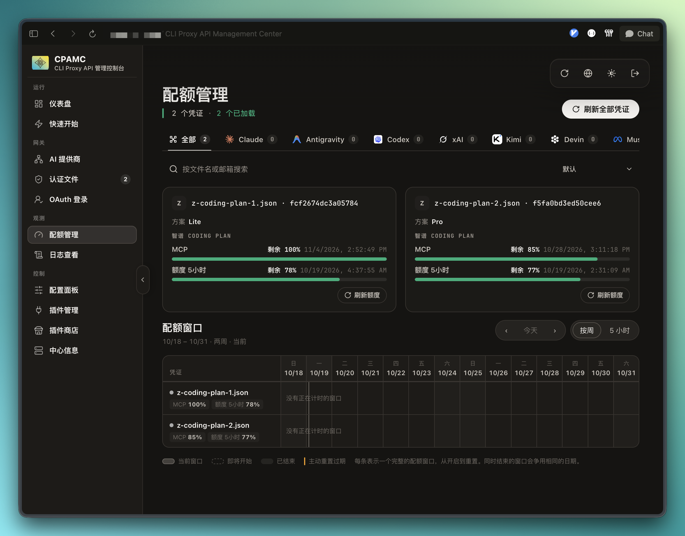

# z-coding-plan

CLIProxyAPI 插件。展示智谱 GLM Coding Plan 额度，并在智谱返回 1308 且带重置时间时，停用那把实际发出请求的凭证，直到该时间。

只支持中国区 BigModel。额度固定请求 https://bigmodel.cn/api/monitor/usage/quota/limit。不支持全球区 api.z.ai，也没有额度地址配置项。中国区 Key 不能拿到全球区使用，反过来也不行。

这里有两份不同的凭证，不要混用：

- 额度认证文件是插件解析的 JSON。它只让管理页的额度页能显示剩余额度，本身不是路由 Key。
- 路由凭证是 CLIProxyAPI 用来请求智谱的上游 API Key。1308 切换跟着实际发出那次请求的凭证 id 走。

## 配置

在 CLIProxyAPI 的配置目录操作，下面称为 CONFIG。认证目录是宿主的 auth-dir，常见是 ~/.cli-proxy-api。

1. 编译动态库，放到宿主加载插件的目录。文件名就是插件 id。

        CGO_ENABLED=1 go build -buildmode=c-shared -o z-coding-plan.so .

   Linux amd64 的目标路径是 CONFIG/plugins/linux/amd64/z-coding-plan.so。

   完成标准：该路径存在，且文件名正好是 z-coding-plan.so。

2. 在 CONFIG/config.yaml 里启用插件。宿主读 enabled 和 priority；quota-warmup-times、quota-warmup-model 见下文额度预热，都可省略。

        plugins:
          enabled: true
          configs:
            z-coding-plan:
              enabled: true
              priority: 1
              quota-warmup-times: "03:00,08:00,13:00,18:00,23:00"

   完成标准：plugins.enabled 为 true，且 plugins.configs.z-coding-plan.enabled 为 true。

3. 每个智谱 Coding Plan Key 在认证目录里放一个文件，权限 0600。一个文件一把 Key。

        {
          "type": "z-coding-plan",
          "label": "Key 1",
          "api_key": "智谱上游 Key"
        }

   type 必须是字符串 z-coding-plan。api_key 必填，填智谱上游 Key，不要填 CLIProxyAPI 的客户端访问密钥。api-key 也可以当作别名。label 可省略，省略时用去掉 .json 的文件名。宿主看到的凭证 id 是去掉 .json 的文件名。

   完成标准：每个文件都是合法 JSON，api_key 非空，type 正好是 z-coding-plan。

4. 额度认证文件同时是 glm-5.3、glm-5.3-flash 的路由凭证，请求由本插件原样转发给智谱，见下文原样转发。宿主上游配置里承接同一批 Key 的 glm 条目要排除这两个模型。

   完成标准：GET /v1/models 里有 glm-5.3，宿主日志里请求的凭证是 z-coding-plan 文件。

5. 重启 CLIProxyAPI。替换 .so 不会影响已经加载它的进程。

   完成标准：日志里出现 plugin registered plugin_id=z-coding-plan。

6. 用管理密钥检查管理接口。

   - GET /v0/management/plugins 里有 z-coding-plan，registered 为 true，supports_quota 为 true。
   - GET /v0/management/auth-files 列出每个新文件，provider 为 z-coding-plan，supports_quota 为 true，并带 auth_index。
   - POST /v8/management/plugins/z-coding-plan/quota，请求体为 {"auth_index":"<auth_index>"}，返回套餐名和窗口。Token 窗口标为额度，积分窗口标为积分，MCP 标为 MCP。

   完成标准：每个额度认证文件都返回窗口，或者返回的错误不是 quota credential not found。

配置成功后，管理页的额度页会列出每把中国区 Coding Plan Key。卡片上的套餐名来自接口，5 小时和 MCP 是两个窗口。数字会随用量变化，下面只是一次成功配置的样子。

## 原样转发

插件同时是 glm-5.3、glm-5.3-flash 的执行器：路由到 z-coding-plan 凭证的 Anthropic Messages 请求，请求体按客户端发来的字节原样发到 https://open.bigmodel.cn/api/anthropic/v1/messages，客户端请求头原样带上，只把鉴权换成该凭证的 Key（X-Api-Key），并去掉逐跳头和转发头；响应按 SSE 事件原样流回。智谱的错误状态码和正文原样交回宿主，1302、1308 处理照旧。

CPA 自带的 claude 执行器会改写请求（Claude Code 伪装、删 thinking、工具改名、地址加 ?beta=true），要让经 CPA 的调用与直连一致，就让 glm 只走本插件：

- api-keys.claude 里承接智谱的条目用 excluded-models 排除这两个模型（或删掉条目），否则宿主会在两条路之间轮换；
- 1302 原样交回客户端：在 oauth.request-scoped-errors 下给 z-coding-plan 配 status 429、match "[1302]"、action stop，宿主不再换 Key 重试。匹配写带方括号的 [1302]，因为智谱的 request_id 以时间开头，13:02 前后的 1308 错误里也会出现 1302 这串数字。

messages-endpoint 可改转发地址，只用于核对时指向本地录制转发，平时不要配。

## 1308 切换

请求失败后，只有错误文本里的 1308 是独立数字，并且带有 YYYY-MM-DD HH:MM:SS 时间戳，才会停用那把凭证。时间按中国时间（UTC+8）读取，停用到该时刻。130812 不算。只有 1308、没有时间戳，也不停用。其他错误不停用。

下一次选择会跳过已停用的凭证 id。插件向宿主声明要看全部优先级的候选（scheduler_across_priorities），在没停用的凭证里先用凭证文件 priority 最高的那一档；否则高优先级那把停用后，宿主只给这一把，每个请求都会先撞一次 1308 才换 Key。如果候选全部停用，就用重置时间最早的那把。停用名单只在内存里，进程退出或插件卸载后清空。

被停用的 id 是实际发出请求的宿主凭证 id，不是额度文件名，除非宿主路由用的就是那个文件。

## 1302 与会话固定

插件不在网关做限流：1302 原样交回客户端，由客户端自己排队重试（配合上文 action stop）。

候选全是智谱 Key（base_url 含 bigmodel.cn）时由插件选 Key。同一个会话（Claude Code 的 X-Claude-Code-Session-Id、Codex 的 Session-Id 等，子任务跟随父会话）的请求固定用同一把 Key，智谱的提示缓存按账号计算，换 Key 会让缓存失效。1302、并发再多都不换；只有这把 Key 被 1308 停用才改用另一把并改绑。高优先级的 Key 恢复后，已绑定到别的 Key 的会话也不搬回去。绑定 1 小时内有效，只存在内存里。

新会话和没有会话标识的请求用 priority 最高那一档里进行中请求最少的一把。进行中请求数在请求结束时减掉，5 分钟内没有结束记录也会自动清掉。

## 额度预热（quota-warmup）

智谱 5 小时额度从窗口内第一次调用开始计时。配置 quota-warmup-times 后，插件每天在这些北京时间点，用每个 z-coding-plan 额度认证文件里的 Key 直接向智谱发一个 max_tokens 为 1 的请求（模型默认 glm-5.3，可用 quota-warmup-model 改），提前开启窗口。留空或省略即关闭。

到点时先查这把 Key 的 5 小时窗口：1 小时内会重置的，等重置后 3 秒再发；还要 1 小时以上才重置的，这次跳过。每次结果写进 CPA 日志，前缀 quota-warmup。

推荐 03:00,08:00,13:00,18:00,23:00：14:00 到 18:00 的双倍消耗时段整个落在 13:00 开始的窗口里，18:00 一到就是新窗口。

## 发布

发布 tag 为 v0.3.0。附上 checksums.txt，以及每个平台一个 zip。zip 根目录只放动态库，例如 z-coding-plan_0.3.0_linux_amd64.zip 里直接是 z-coding-plan.so。

登记字段：id 为 z-coding-plan，name 为 Z Coding Plan，author 为 iamdin，repository 为 https://github.com/iamdin/cliproxyapi-plugin-z-coding-plan，license 为 MIT。
